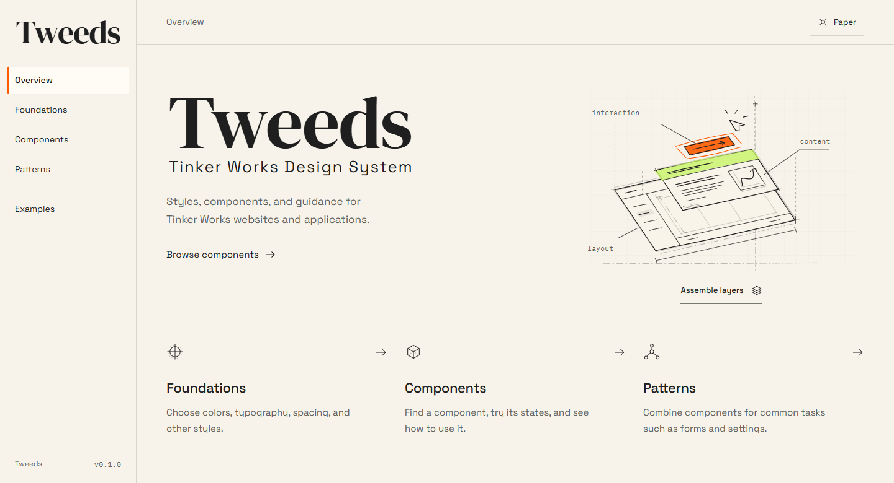
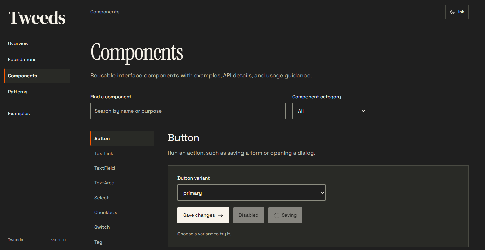

# Tweeds

Tweeds is the design system for Tinker Works. It includes a React component library and a playbook for colors, typography, icons, and common interface patterns. There are two themes: Paper and Ink.

**From curiosity to real things.**



## Run locally

You'll need Node.js 22.12 or later and pnpm 11.25.0.

```sh
pnpm install
pnpm dev
```

Open the playbook at [localhost:5173](http://127.0.0.1:5173).

For component controls and API documentation, start Storybook:

```sh
pnpm storybook
```

Open [localhost:6006](http://127.0.0.1:6006).

## Use the library

The package is `@tinker-works/ui` and requires React 19. To try it in another app, create and install a local package:

```sh
# In this repository
pnpm pack

# In your app
pnpm add /path/to/tinker-works-ui-0.1.0.tgz
```

Import the components and styles:

```tsx
import { Button, ThemeProvider } from '@tinker-works/ui';
import '@tinker-works/ui/styles.css';
import '@tinker-works/ui/fonts.css';

export function App() {
  return (
    <ThemeProvider theme="paper">
      <Button>Save changes</Button>
    </ThemeProvider>
  );
}
```

Use `theme="ink"` for the dark theme. Fonts are bundled locally; omit `fonts.css` if your app already serves them.



## Development

Design tokens live in `src/tokens.json`. After editing them, run `pnpm tokens:build` to update the generated CSS.

| Command | Output |
| --- | --- |
| `pnpm build` | Component library and types in `dist/` |
| `pnpm build:example` | Production playbook in `example-dist/` |
| `pnpm build-storybook` | Static Storybook in `storybook-static/` |

Run the checks before committing:

```sh
pnpm check
pnpm test:browser
pnpm test:visual
```

`pnpm check` runs type checks, unit tests, and all three builds. The browser suite checks interactions, accessibility, and print styles. Visual tests compare desktop and mobile layouts in both themes.

For more detail:

- [Architecture, theming, and adding components](docs/architecture.md)
- [Browser setup, tests, and screenshot baselines](tests/README.md)
